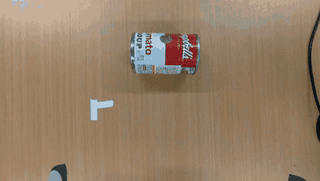
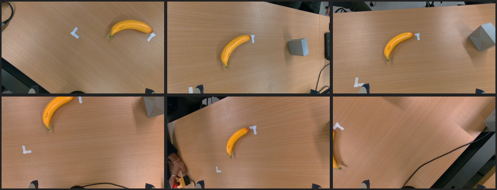
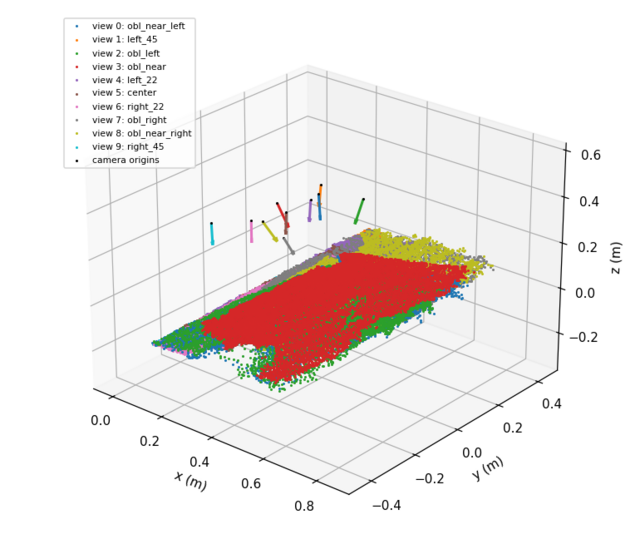
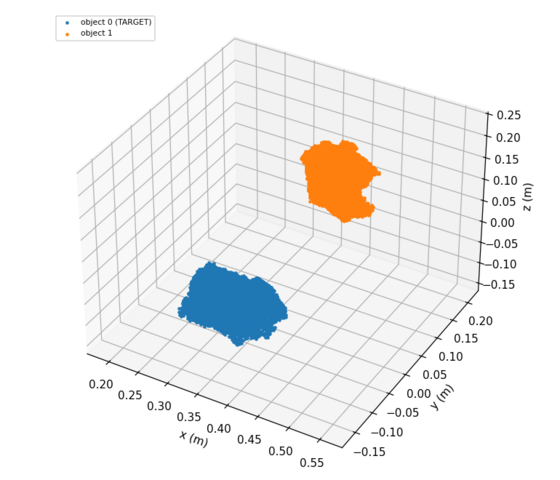
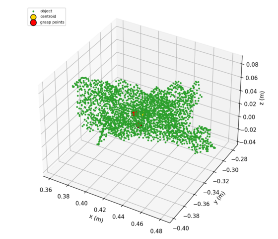
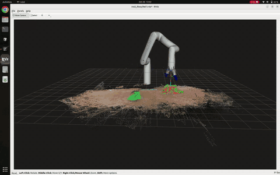
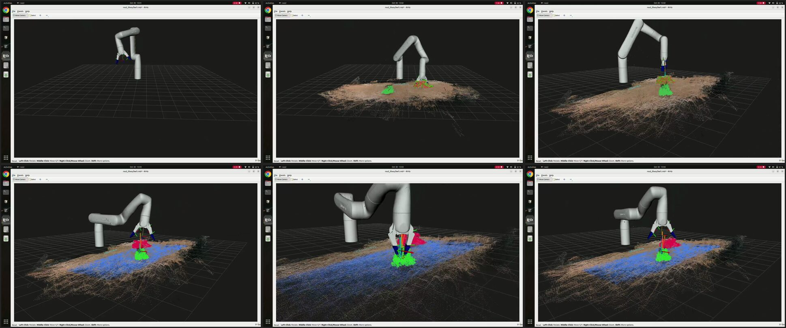
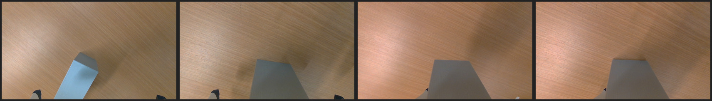

# kinova-gen3-lite-multiview-grasping-ros2

Multi-view eye-in-hand point cloud grasping on a **Kinova Gen3 Lite** with a wrist-mounted **RealSense D405**, running on **ROS 2 Humble** (`ros2_kortex` driver, MoveIt, `realsense2_camera`). The arm scans the table from 10 fixed viewpoints, merges the point clouds, removes the table plane, clusters the objects, synthesises an antipodal grasp for each one and picks it up and puts it back. No assumptions about object shape, size or colour.

The perception and grasp code is plain Python (NumPy / SciPy / Open3D); each stage runs as a ROS 2 node and the point clouds, grasp and plan are published as `/hw7/*` topics for RViz. Course context: RBE 595 homework 6 (point cloud grasp synthesis) and homework 7 (the real robot with multi-view eye-in-hand clouds).

```bash
git clone https://github.com/Schrodingerrs-cat/kinova-gen3-lite-multiview-grasping-ros2.git
cd kinova-gen3-lite-multiview-grasping-ros2
```

Known limitations (the run above succeeded on both objects; an earlier attempt on a thin curved object did not): the views still disagree on the table height by up to about 30 mm (hand-eye calibration error), so close-range refinement does most of the work for the final grasp; very thin or dark objects can be missed or fail the gripper-contact check.

## Demo

A full run on the real arm: the scan, then both objects on the table (a soup can and a gray block) are picked, lifted, put back and released, from one scan (wrist-camera view at 20x speed). Full video: [`wrist_camera.mp4`](runs/20261029_211609/video/wrist_camera.mp4).



**Scan:** colour images from some of the 10 viewpoints (straight-down sweep and oblique views).



**Point clouds:** the 10 views merged in the base frame with the camera positions (left), the segmented object clusters with the target highlighted (middle), and the antipodal grasp points on the target's cloud (right).

<p>
  
</p>

**RViz (live point clouds):** the scan, merged scene, table plane (blue), object clusters (red / green target) and grasp markers are published as ROS topics and shown in RViz together with the robot model. Full screen recording of the run: [`media/rviz_pointclouds.mp4`](media/rviz_pointclouds.mp4).





**Pick and put back:** pre-grasp, at the grasp pose, after the lift, placed back on the table (top row: soup can, bottom row: gray block).



All figures, point clouds and per-step images of the run are in [`runs/20261029_211609/`](runs/20261029_211609/) (`log.txt`, `summary.md`, `results.json`, `scan/`, `object_k/`). An earlier run, with a banana that the gripper missed, is in `runs/old runs/20261029_210833/`. The same clouds can be viewed live in RViz (see below).

## Pipeline (ROS 2 nodes)

`ros2 launch ros2_iface/launch/pick.launch.py` starts one node per stage plus an orchestrator; stages are `std_srvs/Trigger` services, results go out on latched `/hw7/*` topics.

| node / service | what it does |
|---|---|
| `hw7_scan` `/hw7/scan` | go to the scan pose, visit the 10 fixed viewpoints (5 straight down, yawed -45..+45 deg; 5 oblique), publish each view's cloud on `/hw7/view_cloud` and the accumulated cloud on `/hw7/scan_views` (base frame: `p_base = T_base_tool @ X(hand-eye) @ p_cam`) |
| `hw7_perception` `/hw7/perceive` (param `target`) | `perceive.py` (HW 6 steps 1-3): per-view table alignment, ICP, merge + voxel, crop, RANSAC table plane, clusters, then centroid, normals, antipodal pair inside the friction cone, PCA approach; publishes `/hw7/merged /hw7/table /hw7/objects /hw7/target /hw7/grasp` |
| `hw7_planner` `/hw7/plan` | `grasp_plan.py`: pre-grasp / grasp / lift poses, approach tilt and jaw flip searched with MoveIt IK |
| `hw7_executor` `/hw7/execute`, `/hw7/home` | `grasp_exec.py`: pre-grasp, close-range re-synthesis, descend, close, lift, put back |
| `run_pick.py` (manager) | scans once, then per object: perceive, plan, execute; run folder, video, log, summary |

The service response message is JSON `{"info": ..., "log": ...}`. Works for any object shape / size / colour; parameters are in `config.yaml`.

## Setup (once)

* Ubuntu 22.04, ROS 2 Humble, Kinova Gen3 Lite (USB to the PC, powered on), RealSense D405 on a **USB 3** port (USB 2 gives a stalling stream).
* ROS packages: `sudo apt install ros-humble-kinova-gen3-lite-moveit-config ros-humble-kortex-bringup ros-humble-realsense2-camera ros-humble-rmw-cyclonedds-cpp ros-humble-moveit-ros-visualization` (`start_arm.sh` installs the MoveIt ones if missing).
* Python env for the pipeline: `python3 -m venv .venv && .venv/bin/pip install -r requirements.txt`.
* Put this in `~/.bashrc` so every terminal uses the same DDS (mixing middlewares makes nodes silently fail to talk):
  ```bash
  source /opt/ros/humble/setup.bash
  export RMW_IMPLEMENTATION=rmw_cyclonedds_cpp
  ```

## Run it, terminal by terminal

Keep the e-stop in reach and the workspace clear. Open each terminal in the repo folder and start them in this order.

| # | terminal | command | ready when |
|---|---|---|---|
| 1 | arm link + MoveIt | `./start_arm.sh` (asks for `sudo` once: gives the arm's USB network interface an IP, pings `192.168.1.10`, starts MoveIt + RViz) | RViz opens, log says "You can start planning now!" |
| 2 | arm driver | `ros2 launch kortex_bringup gen3_lite.launch.py robot_ip:=192.168.1.10 launch_rviz:=false` | log shows "Configured and activated" for `joint_state_broadcaster`, `joint_trajectory_controller`, `gen3_lite_2f_gripper_controller` (takes ~10 s) |
| 3 | camera | `ros2 launch realsense2_camera rs_launch.py align_depth.enable:=true pointcloud.enable:=true` | log shows the color / depth streams started |
| 4 | check (no motion) | `python3 ros2_iface/smoke_test.py` | prints the joints, the tool position, a camera frame and "IK service up: True" |
| 5 | viewer (optional) | `rviz2 -d ros2_iface/hw7.rviz` | robot, live camera cloud (tick it), and later the scan / objects / grasp |
| 6 | **the pipeline** | `./run_ros.sh` | see below |

`./run_ros.sh` starts one ROS 2 node per stage (scan, perception, planner, executor), the camera keepalive and the orchestrator in one terminal, runs, and shuts them down when it finishes. Arguments are passed to the orchestrator: `./run_ros.sh` = all objects, no countdown; `./run_ros.sh --single` = one object, with a 10 s countdown.

What you see: the arm goes to the scan pose and visits the 10 views (a cloud per view appears in RViz), then for each object (nearest the base first) it plans, picks, lifts, puts it back and releases, and finally returns to the scan pose. Output (log, video, clouds, figures, per-step images) is saved in `runs/<timestamp>/`.

**Stop:** Ctrl-C in terminal 6 (or the e-stop). **Shut down:** Ctrl-C terminals 3, 2, 1.

Without the robot you can still look at a saved run: `.venv/bin/python ros2_iface/viz_node.py --run "runs/old runs/20261029_210833" --object 1`, then `rviz2 -d ros2_iface/hw7.rviz`.

### If something goes wrong

| symptom | cause / fix |
|---|---|
| a node waits forever, or services are "not available" | a terminal without `RMW_IMPLEMENTATION=rmw_cyclonedds_cpp`; close all and restart with the `~/.bashrc` lines |
| "no camera frames" | camera node not running, or not started with `align_depth.enable:=true`; restart terminal 3 |
| driver crashes with `RefreshFeedback` timeout / `sendto() failed ... 101` | the arm's USB link dropped (`ip -o link` shows no `enx...`); reseat the cable, rerun `./start_arm.sh`, restart the driver |
| `ROBOT_IN_FAULT` / arm refuses to move | clear the fault from the arm's web page (`http://192.168.1.10`) or power-cycle the arm, then restart the driver |
| `ros2 control list_controllers` hangs | the driver is not running, or on a different DDS |
| camera stalls / low frame rate | use a USB 3 port and cable |

Calibration (`calibration/hand_eye.json`) is the camera-to-tool transform; the scan views and home pose are in `calibration/table_views.json` and `calibration/scan_joints.json`. The tools that made them (Kortex API) are in `archive/`.

## Point clouds in ROS (RViz)

The nodes publish the pipeline's clouds and grasp as latched topics in `base_link`: `/hw7/scan_views`, `/hw7/merged`, `/hw7/table`, `/hw7/objects` (one colour per cluster), `/hw7/target`, and `/hw7/grasp` (centroid, grasp points, approach, pre-grasp/grasp/lift path). The pipeline nodes publish these themselves; open RViz with `rviz2 -d ros2_iface/hw7.rviz`.

No robot needed: replay a saved run with `.venv/bin/python ros2_iface/viz_node.py --run "runs/old runs/20261029_210833" --object 1`.

## Layout

```
start_arm.sh          USB link to the arm + MoveIt/RViz
run_ros.sh            ros2 launch of the whole pipeline
run_pick.py           orchestrator node
scan.py perceive.py grasp_plan.py grasp_exec.py     stage code used by the nodes
common.py cfg.py      ROS arm/camera/gripper helpers, config loader
ros2_iface/           hw7_nodes.py (the 4 stage nodes), launch/pick.launch.py, robot_ros.py (joint states, TF, FollowJointTrajectory, MoveIt IK/Cartesian path, gripper, camera topics), keepalive.py, viz_node.py + hw7.rviz, smoke_test.py
calibration/          hand_eye.json, table_views.json, scan_joints.json (home pose; old ones commented), tag_in_base.json, tip_offset_measured.json
runs/old runs/<ts>/   one demo run: video, point clouds, figures, per-step images, log
archive/              the earlier Kortex-API version and old calibration (not used)
```

Notes: the camera node publishes aligned depth only while subscribed, so `run_ros.sh` runs `ros2_iface/keepalive.py` first. The arm's own link is USB (RNDIS); if the interface disappears the driver crashes with `RefreshFeedback` timeouts.
